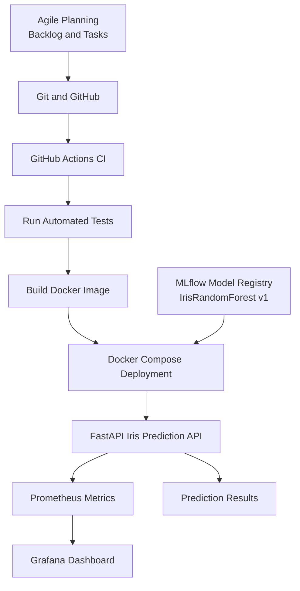

# End-to-End ML DevOps Architecture

## Workflow

1. Plan work through Agile tasks and backlog items.
2. Track code changes with Git and GitHub.
3. GitHub Actions runs automated tests and builds the Docker image.
4. Docker Compose runs the Iris prediction API with the packaged MLflow model.
5. Prometheus collects API metrics, which Grafana visualizes.
